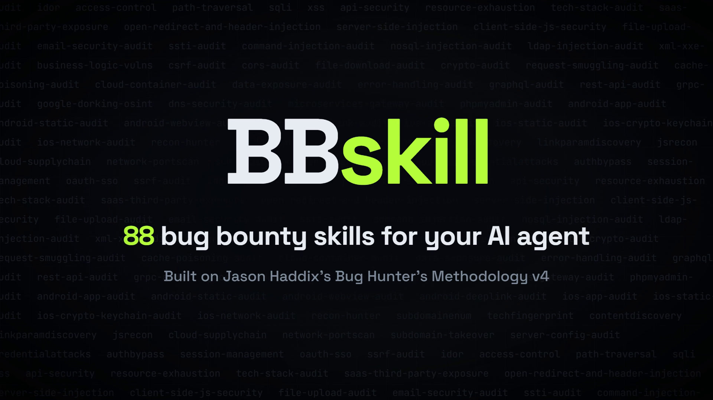

# Universal Bug Bounty Multi-Agent Skills Framework

A production-grade offensive reconnaissance, technology fingerprinting, content discovery, and vulnerability auditing framework. Built on Jason Haddix's *The Bug Hunter's Methodology (TBHM v4)*, real-world bug bounty research, and automated multi-agent task distribution.

[](media/bbskill-launch.mp4)

*Click the image to watch the 21-second launch video.*

---

## 1. System Architecture Overview

Modern offensive audits fail when a single AI agent attempts to perform broad recon, parameter mining, and vulnerability exploitation simultaneously—resulting in token fatigue, hallucinations, missed assets, and shallow testing.

This framework partitions complex security assessments across **51 specialized skills** and **60+ dedicated subagents**, coordinated by the **`recon-hunter` 16-phase master pipeline**:

```
                                  [ TARGET ROOT DOMAIN / IP ]
                                               │
                                               ▼
                             ┌───────────────────────────────────┐
                             │    `recon-hunter` Master Engine   │
                             │   Continuous 16-Phase Pipeline    │
                             └─────────────────┬─────────────────┘
                                               │
       ┌───────────────────────────────────────┼───────────────────────────────────────┐
       ▼                                       ▼                                       ▼
┌───────────────────────────────┐ ┌───────────────────────────────┐ ┌───────────────────────────────┐
│           PHASE 1:            │ │           PHASE 2:            │ │           PHASE 3:            │
│  Attack Surface & Discovery   │ │ Authentication & Credentials  │ │ Vulnerability & Business Logic│
├───────────────────────────────┤ ├───────────────────────────────┤ ├───────────────────────────────┤
│ • recon-hunter (Master Recon) │ │ • credentialattacks (40 Chks) │ │ • ssrf-audit (55 Checks)      │
│ • subdomainenum (50 Checks)   │ │ • authbypass (30 Checks)      │ │ • access-control (25 Checks)  │
│ • techfingerprint (40 Checks) │ └───────────────────────────────┘ │ • business-logic (25 Checks)  │
│ • contentdiscovery (50 Checks)│                                   │ • api-security (25 Checks)    │
│ • linkparamdiscovery (40 Chks)│                                   │ • resource-exhaustion (25 Chk)│
│ • jsrecon (Secrets & AST)     │                                   └───────────────────────────────┘
│ • cloud-supplychain (Buckets) │
└──────────────┬────────────────┘
               │
               ▼
┌──────────────────────────────────────────────────────────────────────────────────────────────────┐
│                                   SHARED REPOSITORY ASSETS                                       │
├───────────────────────────────┬──────────────────────────────────┬───────────────────────────────┤
│ • wordlists/ (Consolidated)   │ • references/ (TBHM Playbooks)   │ • artifacts/ (JSON/Markdown)  │
│ • setup.sh (Tool Automation)  │ • .cursor/rules/ (IDE Rules)     │ • SETUP.md (Full Tool Index)  │
└───────────────────────────────┴──────────────────────────────────┴───────────────────────────────┘
```

---

## 2. Directory & Component Layout

```
BBskill/
├── .agents/
│   └── skills/                         # Master Agent Skill Definitions
│       ├── recon-hunter/               # 16-Phase continuous unauthenticated recon-to-bug pipeline
│       ├── google-dorking-osint/       # 49 Google dorks + OSINT leak sites; dork generator and triage
│       ├── subdomainenum/              # 50-Check subdomain enumeration & takeover audit
│       ├── techfingerprint/            # 40-Check stack, CDN, origin IP, and unauth service audit
│       ├── contentdiscovery/           # 50-Check fuzzing, historical archives, and config exposure
│       ├── linkparamdiscovery/         # 40-Check modern crawling, SSRF params, and WebSockets
│       ├── jsrecon/                    # JS de-minification, 60+ secret regexes, SSR extraction, 50 JSA checks + js_sink_audit.py
│       ├── cloud-supplychain/          # S3/GCS/Azure/Firebase & NPM dependency confusion
│       ├── credentialattacks/          # 40-Check password policy, brute-force & MFA bypass
│       ├── authbypass/                 # 30-Check login bypass, NoSQL/SQLi & JWT manipulation
│       ├── ssrf-audit/                 # 55-Check remote fetchers, bypasses, cloud IMDS & blind SSRF
│       ├── access-control/             # 25-Check horizontal IDOR, BOLA & privilege escalation
│       ├── api-security/               # 25-Check Swagger/GraphQL/CORS + AA (25) and AI (15) checklists, api_probe.py
│       ├── resource-exhaustion/        # 25-Check rate limiting, velocity controls & DoS
│       ├── target-router/              # Smart start: routes fingerprints and params to skills
│       ├── tech-stack-audit/           # ~470 product exposure and version checks (6 reference files)
│       ├── saas-third-party-exposure/  # Vendor tags and client-side keys, public vs secret
│       ├── open-redirect-and-header-injection/
│       ├── server-side-injection/      # SSTI, command injection, XXE, NoSQL, LDAP, deserialization
│       ├── client-side-js-security/    # Prototype pollution, postMessage, storage, service workers
│       ├── file-upload-audit/          # Upload handling and parser abuse (UP + FU-001..020, test file generator)
│       ├── email-security-audit/       # SPF, DKIM, DMARC, CAA, BIMI, MX, mail forms, SMTP; email_dns_audit.py
│       ├── ssti-audit/                 # Template injection: engine matrix, injection points, blind SSTI
│       ├── command-injection-audit/    # OS command injection: separators, blind, OOB, source sinks
│       ├── nosql-injection-audit/      # NoSQL operator and syntax differential probes
│       ├── ldap-injection-audit/       # LDAP filter injection: wildcard, boolean, escape probes
│       ├── xml-xxe-audit/              # XML injection, XXE, XInclude, XSLT, XPath
│       ├── business-logic-vulns/       # 20 logic checks: price, currency, races, refunds, trials, tiers
│       ├── csrf-audit/                 # Deep CSRF: 20 core + bypass matrix, PoCs, token probe and analyzer
│       ├── cors-audit/                 # Deep CORS: 15 core + origin bypass matrix, chains, PoCs, probe
│       ├── file-download-audit/        # Download auth, IDOR, headers, listings, signed URLs, PDF generation
│       ├── crypto-audit/               # Crypto misuse 15 checks, source scanner, ciphertext analyzer
│       ├── request-smuggling-audit/    # Desync detection: CL.TE/TE.CL/TE.TE/H2, timing-first probe
│       ├── cache-poisoning-audit/      # Cache poisoning and deception, buster-only probe
│       ├── cloud-container-audit/      # Cloud storage, metadata, Docker/K8s/etcd, IAM, functions
│       ├── data-exposure-audit/        # Secrets, files, storage, API PII, URL and Referer leaks
│       ├── error-handling-audit/       # Error disclosure, enumeration differentials, error pages
│       ├── graphql-audit/              # GraphQL schema, cost limits, authz, APQ; probe
│       ├── rest-api-audit/             # REST CRUD authz lifecycle, HEAD/OPTIONS, sort/filter, versions
│       ├── grpc-audit/                 # gRPC reflection, auth, transport, metadata; probe + grpcurl
│       ├── idor/                       # Audit authorized applications and APIs for Insecure Direct Object References / B
│       ├── network-portscan/           # Scan every TCP port on explicitly authorized hosts, then identify listening serv
│       ├── oauth-sso/                  # Audit authorized OAuth 2.0, OpenID Connect, SAML 2.0 and enterprise SSO (Kerbero
│       ├── path-traversal/             # Audit authorized applications for path traversal, local/remote file inclusion an
│       ├── server-config-audit/        # Audit authorized Apache, Nginx, IIS, Tomcat, Jetty, WildFly, WebLogic, WebSphere
│       ├── session-management/         # Audit authorized web applications across 40 session-management checks covering t
│       ├── sqli/                       # Audit authorized applications for SQL injection across 50 checks — quote/break-r
│       ├── subdomain-takeover/         # Audit authorized domains for subdomain takeover risk across 50 dangling DNS and 
│       ├── xss/                        # Audit authorized applications for cross-site scripting across 60 checks — reflec
│       ├── dns-security-audit/         # DNS zone, DNSSEC, DoH/DoT, recursion, record disclosure (Kali dig, dnsrecon)
│       └── microservices-gateway-audit/# Audit skill
├── .cursor/
│   └── rules/                          # Cursor IDE Rule (.mdc) files with glob auto-binding
├── wordlists/                          # Consolidated security dictionaries & payload files
├── artifacts/                          # Standardized output directory for audit reports
├── setup.sh                            # Automated installer for Go, Python & binary tools
├── SETUP.md                            # Comprehensive tool catalog & installation instructions
├── AGENTS.md                           # Universal framework specification & capability index
├── CLAUDE.md                           # Assistant instructions for Claude Code
└── README.md                           # Project architecture & IDE installation guide
```

---

## 3. How to Install & Configure Agents Across Different IDEs

This framework is built using open standards (Markdown with YAML frontmatter) and natively integrates with leading AI code editors and CLI assistants:

### 1. Cursor IDE
Cursor natively recognizes rule definitions located in `.cursor/rules/` and `.cursorrules`:
1. **Automated Loading:** The repository comes pre-configured with `.cursorrules` in the root and 14 `.mdc` rules under `.cursor/rules/`.
2. **Context Binding:** When working on files matching specific patterns (e.g., `*api*`, `*subdomain*`, `*recon*`), Cursor automatically loads the corresponding skill rule.
3. **Usage:** Open the Cursor Composer (`Ctrl+I` / `Cmd+I`) or Chat (`Ctrl+L` / `Cmd+L`) and reference any skill:
   ```
   @recon-hunter execute unauthenticated attack surface reconnaissance on target.com
   ```

---

### 2. Antigravity / Gemini CLI
Antigravity automatically discovers skills defined in `.agents/skills/<skill_name>/SKILL.md`:
1. **Customization Root:** The framework structure inside `.agents/` adheres directly to the Antigravity Agent customization standard.
2. **Dynamic Skill Activation:** Antigravity reads the YAML frontmatter in each `SKILL.md`. When your prompt matches triggers (such as `"recon"`, `"subdomain"`, `"find bugs"`, or `"api security"`), the assistant activates that skill and its subagents.
3. **Verification:**
   ```bash
   # Antigravity CLI will detect skills in .agents/skills/
   agy --version
   ```

---

### 3. Claude Code (Anthropic CLI)
Claude Code uses `CLAUDE.md` in the project root as its system prompt and rules configuration:
1. **Pre-Configured:** `CLAUDE.md` already registers all 51 skills, tool prerequisites, and output paths.
2. **Execution:** Launch Claude Code from within the repository root:
   ```bash
   cd BBskill
   claude
   ```
3. **Prompt Example:**
   ```
   Run the subdomainenum skill against example.com and verify all 50 checks.
   ```

---

### 4. Windsurf IDE (Codeium Cascade)
Windsurf supports project-specific guidelines through `.windsurfrules`:
1. **Setup:** Symlink or copy `CLAUDE.md` or `.cursorrules` to `.windsurfrules`:
   ```bash
   cp .cursorrules .windsurfrules
   ```
2. **Usage:** In Cascade Chat, reference `@AGENTS.md` or any skill file under `.agents/skills/`.

---

### 5. VS Code (GitHub Copilot Agent Mode / Continue.dev / Cline)
1. **GitHub Copilot Agent Mode:**
   Create `.github/copilot-instructions.md` that points to `AGENTS.md`:
   ```bash
   mkdir -p .github
   echo "Follow instructions and skills defined in AGENTS.md and .agents/skills/" > .github/copilot-instructions.md
   ```
2. **Continue.dev:**
   In `~/.continue/config.json`, add this repository as a context provider or reference `AGENTS.md` in your custom slash commands.
3. **Cline / Roo Code:**
   Point your workspace instructions to `AGENTS.md` and instruct Cline to delegate tasks across `.agents/skills/`.

---

### 6. Aider / OpenAI Codex / OpenCode / DeepSeek
Run CLI-based pair programming agents while passing `AGENTS.md` as the system context:
```bash
# Using Aider
aider --read AGENTS.md --read .agents/skills/recon-hunter/SKILL.md

# Using OpenCode / Custom LLM wrappers
cat AGENTS.md | llm-cli "Execute phase 1 on target.com"
```

---

## 4. Environment & Tooling Setup

Before running active security checks, install the required command-line utilities.

### Automated Setup (Debian / Ubuntu / Kali / WSL2)
```bash
chmod +x setup.sh
./setup.sh
```

### Health Check Verification
Verify installed tools at any time:
```bash
for tool in subfinder httpx dnsx naabu katana nuclei shuffledns massdns ffuf waybackurls gau waymore hakrawler gospider trufflehog gitleaks cero subjack gowitness fingerprintx interactsh-client arjun wafw00f nmap jq curl gh; do
  which "$tool" &>/dev/null && echo -e "\e[32m[+] $tool: INSTALLED\e[0m" || echo -e "\e[31m[-] $tool: MISSING\e[0m"
done
```
For manual installation instructions and API key configurations, consult [SETUP.md](SETUP.md).

---

## 5. Execution Workflows

### Workflow 1: Continuous Full-Surface Recon (`recon-hunter`)
When starting an engagement with an apex domain (`target.com`):
1. Activate [recon-hunter](.agents/skills/recon-hunter/SKILL.md).
2. It executes all 16 phases sequentially:
   - **Phase 01–04:** Passive Subdomains $\rightarrow$ DNS Resolution $\rightarrow$ Port Scan $\rightarrow$ Subdomain Takeover.
   - **Phase 05–08:** Historical URLs $\rightarrow$ Active Katana Crawl $\rightarrow$ Ffuf Directory Fuzzing $\rightarrow$ JS Secret Extraction & SSR.
   - **Phase 09–12:** Nuclei Automated Scan $\rightarrow$ Cloud Storage (S3/GCS/Firebase) $\rightarrow$ Config Exposure $\rightarrow$ CORS Verification.
   - **Phase 13–16:** SSRF Mining $\rightarrow$ GraphQL Introspection $\rightarrow$ Org Secrets & Dependency Confusion $\rightarrow$ Gowitness Triage.
3. Consolidates actionable findings into `artifacts/recon_hunter_ranked_report.txt`.

### Workflow 3: Smart Start (Routing)
After recon has written fingerprints, parameters, or URLs to `artifacts/<target>/`:

```bash
python3 scripts/route_target.py --target example.com --workspace ~/Documents/bugbounty \
  --fingerprint artifacts/example.com/techfingerprint.txt \
  --params artifacts/example.com/params.txt --urls artifacts/example.com/urls.txt
```

The router prints the skills to start, the matched checklist rows, and each row's class. It is passive and never sends traffic. Start `passive` and `bounded` rows in scope. Ask before any `authorized-only` row.

### Workflow 2: Targeted Module Audits
Target individual attack vectors by directly instructing subagents:
- **API Auditing:** [api-security](.agents/skills/api-security/SKILL.md) (Interactive Swagger, GraphQL depth limits, BOLA, CORS credentials).
- **Client-Side Secrets:** [jsrecon](.agents/skills/jsrecon/SKILL.md) (Source map recovery, 60+ secret regexes, Next.js hydration props).
- **Broken Access Control:** [access-control](.agents/skills/access-control/SKILL.md) (Horizontal IDOR, tenant crossing, vertical privilege escalation).
- **SSRF & Cloud Metadata:** [ssrf-audit](.agents/skills/ssrf-audit/SKILL.md) (Image proxies, AWS IMDSv1/v2, OOB Interactsh confirmation).
- **Cloud & Supply Chain:** [cloud-supplychain](.agents/skills/cloud-supplychain/SKILL.md) (S3/GCS/Azure permutations, Firebase RTDB, NPM 404 namespace claims).

---

## 6. Standards & Operational Rules

### Severity Kill Rules
To prevent low-signal, non-actionable findings from reaching reports:
- **KILL** — Nuclei false positives with no live exfiltration or reproduction.
- **KILL** — CORS without `Access-Control-Allow-Credentials: true` (unless sensitive unauthenticated data leaks).
- **KILL** — Exposed `.git` containing only empty configuration without remote URLs or commits.
- **KILL** — Cloud buckets where `ListObjects` returns HTTP 403 `AccessDenied`.
- **KILL** — Dependency confusion package names that do not match internal corporate namespace patterns.
- **DOWNGRADE P1 $\rightarrow$ P2** — Secrets confirmed live but restricted to read-only/viewer scopes.
- **KEEP** — Any secret that validates against live upstream APIs (`sts get-caller-identity`, `/user`, `auth.test`).

### Proof-of-Concept (PoC) Standard
Every vulnerability finding must include a copyable `curl` command that a triager can execute within 60 seconds:
```bash
curl -sk -X GET "https://TARGET/api/v1/user/1024" \
  -H "Authorization: Bearer <unprivileged_token>" \
  | jq '.' | head -20
```
- **Data Exfiltration Cap:** Maximum **50 records**. Prefer `?shallow=true`, `?limit=1`, or `COUNT(*)` over bulk data dumps.

---

## 7. Standard Output Artifacts

All structured outputs are stored in `artifacts/`:
- `artifacts/live_subdomains.txt` & `artifacts/resolved_subdomains.json`
- `artifacts/technology_profile.json`
- `artifacts/discovered_endpoints.txt` & `artifacts/discovered_parameters.json`
- `artifacts/sensitive_files.txt` & `artifacts/exposed_admin_panels.txt`
- `artifacts/cloud_storage_findings.txt` & `artifacts/dep_confusion_candidates.txt`
- `artifacts/org_secrets_findings.json` & `artifacts/recon_hunter_ranked_report.txt`
- `artifacts/credential_audit_report.json` & `artifacts/auth_bypasses_confirmed.txt`
- `artifacts/ssrf_vulnerability_report.json` & `artifacts/api_security_audit_report.json`
- `artifacts/idor_vulnerability_matrix.json` & `artifacts/business_logic_flaws_report.json`
